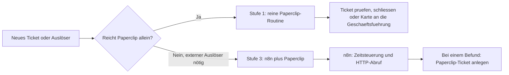

# KI-Team-Kostprobe

Kostenlose, öffentliche Kostprobe aus dem späteren Bauplan-Produkt „Agentisches Büro mit Paperclip, Hermes und
n8n". Sie zeigt das Muster an einer **frei erfundenen** Musterfirma GmbH: eine Mini-Firmenvorlage für Paperclip
und zwei Beispiel-Routinen nach dem Entscheidungsmodell „Paperclip zuerst, n8n nur wenn nötig".

## Wie das Muster funktioniert

Die beiden Beispiele in `routinen-beispiele/` zeigen je eine Stufe davon. Mehr Stufen und das volle
Entscheidungsmodell stehen im kostenpflichtigen Bauplan.

## Was hier drin ist

- `firmenvorlage/` – Minimal-Vorlage für eine Paperclip-Firma: Hausregeln, Ablaufschema, ein Beispiel-Agentenprofil.
- `routinen-beispiele/` – zwei fiktive Routinen der Musterfirma GmbH:
  - **Stufe 1 (reine Paperclip-Routine):** Rechnungsprüfung, läuft komplett innerhalb von Paperclip.
  - **Stufe 3 (n8n + Paperclip):** wöchentlicher Erreichbarkeits-Check; n8n übernimmt den Auslöser und legt bei
    einem Fund ein Paperclip-Ticket an.
- `LIZENZHINWEISE.md` – was unter welcher Lizenz steht.

## Was hier NICHT drin ist

- Keine echten Zugangsdaten, IP-Adressen, Domains oder Personendaten – alles ist frei erfunden.
- Kein n8n-Code und kein n8n-Docker-Image, nur selbst geschriebene Workflow-Dateien.
- Keine Werkzeug- oder Anbieterbindung: die Vorlagen sind bewusst allgemein gehalten.

## Voraussetzungen

Eine eigene Paperclip-Instanz und, für das zweite Beispiel, eine eigene n8n-Installation. Beide werden hier nicht
mitgeliefert, siehe `LIZENZHINWEISE.md`.

## Der volle Bauplan

Diese Kostprobe zeigt nur einen Ausschnitt. Das vollständige, bereinigte Grundgerüst (komplette Firmenvorlage,
Ticket-Skripte für Karten und Übergaben, das ganze Entscheidungsmodell, mehr Routinen-Beispiele, Hermes-Vorlagen
und eine Installationsanleitung) gibt es als einmalig kostenpflichtigen „Bauplan". Link folgt hier, sobald die
Seite online ist.

## Lizenz

Der Inhalt dieses Repos steht unter der MIT-Lizenz, siehe `LICENSE`. Hinweise zu Paperclip, Hermes und n8n stehen
in `LIZENZHINWEISE.md`.
