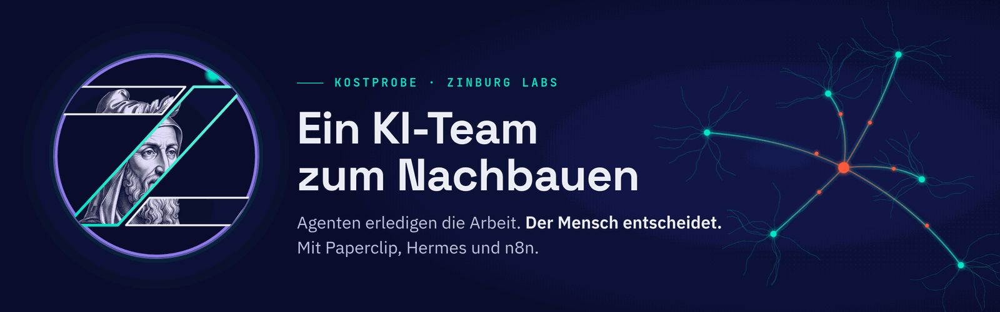

  

  
  
  

# KI-Team-Kostprobe

**Agenten erledigen die Arbeit. Der Mensch entscheidet.** Diese Kostprobe zeigt an einer frei erfundenen
Musterfirma GmbH, wie ein kleines KI-Team mit **Paperclip**, **Hermes** und **n8n** organisiert ist: eine
Mini-Firmenvorlage und zwei Beispiel-Routinen nach dem Entscheidungsmodell „Paperclip zuerst, n8n nur wenn nötig“.

Sie ist ein kostenloser Ausschnitt aus dem **Bauplan**, dem bereinigten Grundgerüst des KI-Teams hinter
[Zinburg Consulting](https://consulting.zinburg.dev).

> **Vergil:** Alles hier ist erfunden, die Musterfirma, die Rechnungen, sogar ihre Webseite.
> Nur das Muster ist echt. Das habe ich persönlich geprüft.

---

## So arbeitet das Team

Die Agenten bereiten vor, prüfen und melden. **Entschieden wird beim Menschen:** Alles Auffällige landet als
Karte bei der Geschäftsführung. Gezahlt, gesendet oder gelöscht wird nichts ohne Freigabe.

## Was drin ist

| Ordner | Inhalt |
|---|---|
| [`firmenvorlage/`](firmenvorlage/) | Hausregeln, Ablauf jedes Laufs und ein Beispiel-Agentenprofil für eine Paperclip-Firma |
| [`routinen-beispiele/stufe-1-…`](routinen-beispiele/stufe-1-rechnungspruefung-paperclip/) | **Stufe 1:** Rechnungsprüfung, läuft komplett in Paperclip |
| [`routinen-beispiele/stufe-3-…`](routinen-beispiele/stufe-3-woechentlicher-abgleich-n8n/) | **Stufe 3:** wöchentlicher Erreichbarkeits-Check, n8n löst aus und legt bei einem Befund ein Ticket an |
| [`LIZENZHINWEISE.md`](LIZENZHINWEISE.md) | was unter welcher Lizenz steht |

## In drei Schritten ausprobieren

1. **Vorlage übernehmen:** `firmenvorlage/HAUSREGELN.md` und `LAUF.md` in die eigene Paperclip-Firma übernehmen und
   die Platzhalter wie `[Dein Name]` ersetzen.
2. **Rolle anlegen:** `firmenvorlage/AGENTS.beispiel.md` als Vorlage für den ersten Agenten nehmen und die
   Stufe-1-Routine nachbauen.
3. **Auslöser von außen:** `workflow-demo.json` in eine eigene n8n-Installation importieren, Ziel-URL und
   Paperclip-Zugang eintragen (als n8n-Credential, nie im Workflow).

**Voraussetzungen:** eine eigene Paperclip-Instanz und für das zweite Beispiel eine eigene n8n-Installation. Beides
liegt nicht bei, siehe [`LIZENZHINWEISE.md`](LIZENZHINWEISE.md).

## Was nicht drin ist

- Keine echten Zugangsdaten, IP-Adressen, Domains oder Personendaten. Alles ist frei erfunden.
- Kein n8n-Code und kein n8n-Docker-Image, nur selbst geschriebene Workflow-Dateien.
- Keine Bindung an einen Anbieter: Die Vorlagen sind bewusst allgemein gehalten.

## Der volle Bauplan

Die Kostprobe zeigt einen Ausschnitt. Der **Bauplan** enthält das vollständige, bereinigte Grundgerüst:
die komplette Firmenvorlage, Ticket-Skripte für Karten und Übergaben, das ganze Entscheidungsmodell mit allen
Stufen, mehr Routinen-Beispiele, Hermes-Vorlagen und eine Installationsanleitung.

**→ [consulting.zinburg.dev/bauplan](https://consulting.zinburg.dev/bauplan)**

Wie das Team im Alltag arbeitet, zeigt die Reihe „Das muss doch besser gehen“ auf
[YouTube](https://www.youtube.com/playlist?list=PLaBw_gEF2v6E).

## Lizenz

Der Inhalt dieses Repos steht unter der MIT-Lizenz, siehe [`LICENSE`](LICENSE). Hinweise zu Paperclip, Hermes und
n8n stehen in [`LIZENZHINWEISE.md`](LIZENZHINWEISE.md).

Zinburg Consulting · IT- und KI-Beratung · <a href="https://consulting.zinburg.dev">consulting.zinburg.dev</a>

