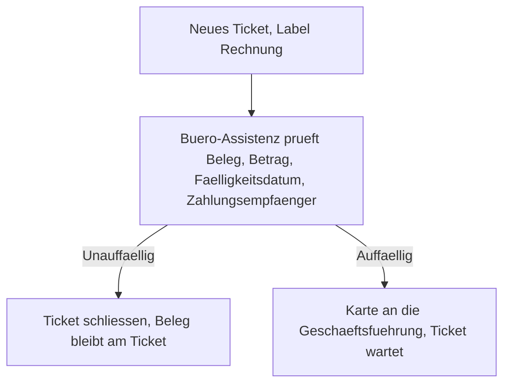

# Stufe 1: Rechnungsprüfung (reine Paperclip-Routine)

Beispiel-Routine der fiktiven Musterfirma GmbH. Läuft komplett innerhalb von Paperclip, ohne n8n: ein Trigger
reicht, weil die Prüfung selbst nur Paperclip-Daten braucht (Ticket-Felder, Anhänge).

## Ablauf

1. Auslöser: neues Ticket mit Label „Rechnung" (z. B. aus einer Mail-Postfach-Anbindung oder manuell angelegt).
2. Die Büro-Assistenz (siehe `firmenvorlage/AGENTS.beispiel.md`) prüft: Beleg als Anhang vorhanden, Betrag und
   Fälligkeitsdatum lesbar, Zahlungsempfänger bekannt.
3. Unauffällig → Ticket mit Zusammenfassung schließen, Beleg bleibt am Ticket.
4. Auffällig (Betrag ungewöhnlich hoch, kein Beleg, unbekannter Empfänger) → Karte an die Geschäftsführung,
   Ticket wartet auf Antwort.

## Ablauf als Diagramm

## Beispiel-Ticket (fiktiv)

> Rechnung Bürobedarf GmbH, 128,40 €, fällig 15.12. Beleg als PDF angehängt. Geprüft: Betrag und
> Fälligkeitsdatum passen zum Beleg, Zahlungsempfänger bereits dreimal zuvor bezahlt. Keine Auffälligkeit,
> Ticket erledigt.

## Warum Stufe 1 reicht

Die Prüfung braucht nichts außerhalb von Paperclip (keinen externen Trigger, keine andere API) – genau das
unterscheidet Stufe 1 von Stufe 3 im zweiten Beispiel.
