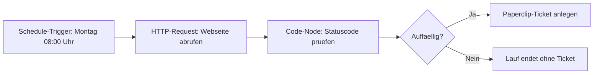

# Stufe 3: wöchentlicher Erreichbarkeits-Check (n8n + Paperclip)

Beispiel-Routine der fiktiven Musterfirma GmbH. Diesmal reicht Paperclip allein nicht: der Auslöser ist ein
externer, zeitgesteuerter Check gegen die eigene Webseite. n8n übernimmt Zeitsteuerung und den HTTP-Abruf,
Paperclip bekommt nur das Ergebnis als Ticket.

## Ablauf (siehe `workflow-demo.json`)

1. **Schedule-Trigger:** jeden Montag 08:00 Uhr.
2. **HTTP-Request-Node:** ruft `https://www.musterfirma-gmbh-beispiel.de` ab.
3. **Code-Node:** prüft Statuscode gegen „ok/nicht ok".
4. **Bei Auffälligkeit:** HTTP-Request-Node gegen die Paperclip-API, legt ein Ticket mit Befund an.
5. **Sonst:** Lauf endet ohne Ticket (kein Rauschen bei grünem Zustand).

## Ablauf als Diagramm

## Zum Importieren

`workflow-demo.json` in eine eigene n8n-Installation importieren. Platzhalter ersetzen:

- `PAPERCLIP_API_URL` / Zugangsdaten für die Paperclip-API (eigene n8n-Credential anlegen, nicht im Workflow
  hinterlegen).
- Ziel-URL im HTTP-Request-Node (`https://www.musterfirma-gmbh-beispiel.de` ist frei erfunden).

## Warum Stufe 3 hier nötig ist

Der Auslöser (Zeitsteuerung + externer HTTP-Abruf) liegt außerhalb von Paperclip. Das Entscheidungsmodell im
vollen Bauplan erklärt, wann Stufe 1 (nur Paperclip), Stufe 2 (Paperclip-Routine mit externem Lesezugriff) oder
Stufe 3 (n8n als Auslöser) die richtige Wahl ist.
